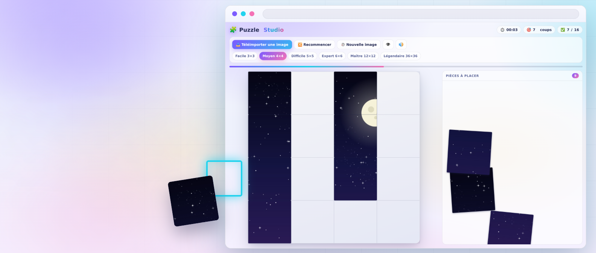
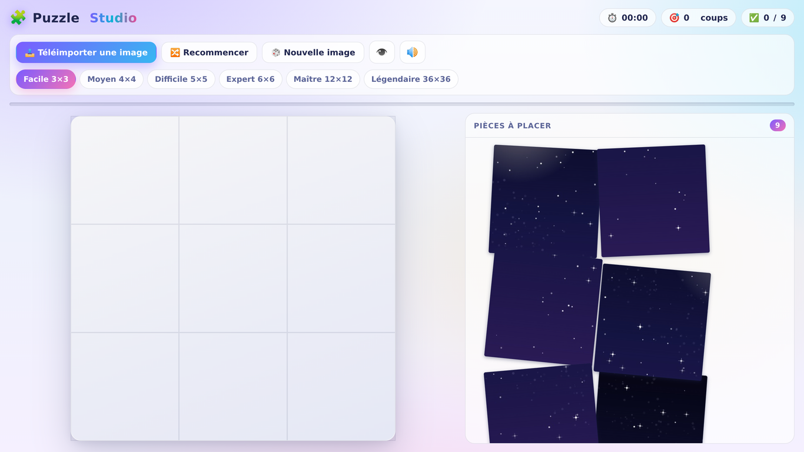
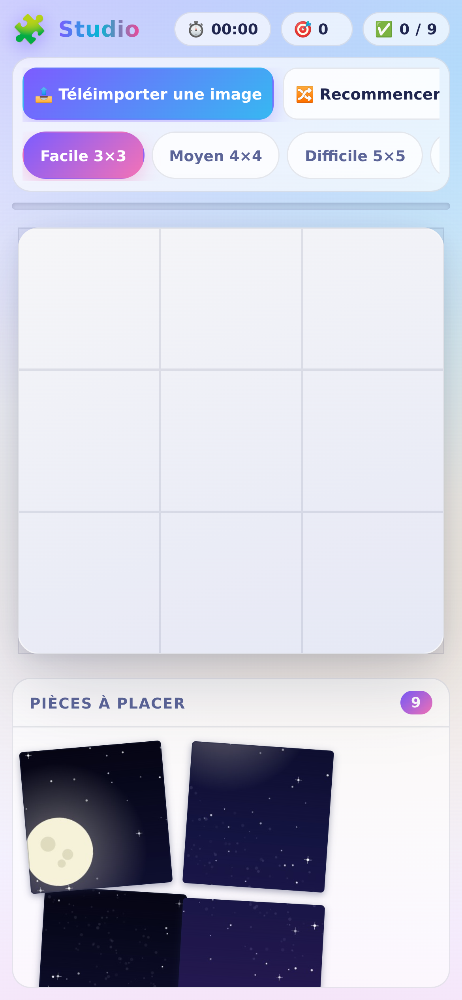

# 🧩 Puzzle Studio



Jeu de puzzle interactif **complet et autonome** — un seul fichier `index.html` (HTML + CSS + JavaScript), zéro dépendance, fonctionne hors ligne.

## 🚀 Lancer le jeu

- **Option 1** : ouvrir `index.html` directement dans un navigateur (double-clic).
- **Option 2** : servir le dossier :
  ```bash
  python3 -m http.server 8000
  # puis ouvrir http://localhost:8000
  ```

## ✨ Fonctionnalités

| Fonctionnalité | Détail |
|---|---|
| 📤 **Import d'image** | « Téléimporter une image » : l'image de l'appareil est redimensionnée (max 1600 px) puis découpée dynamiquement selon la grille |
| 🎲 **11 images intégrées** | Ambiances **générées aléatoirement par canvas** (géométrique, coucher de soleil, vagues, forêt, océan, nuit étoilée, montagnes, aurore boréale, désert, abstrait, ville) + couleurs renouvelées à chaque génération — le jeu marche sans aucun fichier externe |
| 🎚️ **6 niveaux** | Facile 3×3 · Moyen 4×4 · Difficile 5×5 · Expert 6×6 · Maître 12×12 · Légendaire 36×36 (1 296 pièces) |
| 🖱️ **Glisser-déposer** | Pointer Events (souris, tactile, stylet) avec aimantation (*snap*) près du bon emplacement |
| 👆 **Mode clic** | 1ᵉʳ clic = sélection + surlignage de l'emplacement · 2ᵉ clic (pièce ou emplacement) = pose directe |
| 📊 **Statistiques** | Chronomètre, compteur de coups, pièces placées, barre de progression |
| 🏆 **Victoire** | Modale de félicitations + confettis + son |
| 📱 **Responsive** | Mise en page adaptée ordinateur / tablette / mobile, repositionnement automatique à redimensionnement |
| 🔊 **Son** | Effets audio WebAudio, activables/désactivables |

## 🎮 Commandes

- **Glisser** une pièce vers son emplacement → elle s'aimante (l'emplacement pulse en cyan quand on approche).
- **Cliquer** une pièce puis son emplacement (ou cliquer 2 fois la pièce) pour la poser sans glisser.
- 🔀 **Recommencer** : remélanger · 🎲 **Nouvelle image** : autre ambiance · 👁️ : voir l'image complète.

## ⚡ Performance

Optimisations clés (le 36×36 = 1 296 pièces doit rester fluide) :

- **Image déclarée une seule fois** via la variable CSS `--puzzle-img` héritée — jamais dupliquée dans le style des 1 296 pièces (≈117 Mo → ≈250 Ko, gain ×470 sur la mémoire et le recalcul de style).
- **Repositionnement léger** : un redimensionnement ne recrée plus les ~4 000 nœuds du DOM (les éléments existants sont simplement repositionnés) ; calcul des réserves sans rétroaction → pas de cascade ResizeObserver.
- **Grilles denses (≥ 100 pièces)** : classe `.dense` supprime les ombres portées par pièce (peinture divisée), contour léger à la place.
- Images importées réduites à 1024 px sur les grosses grilles (12×12+).

## 🧪 Tests

Deux suites de tests automatisés (jsdom) valident le rendu, le mélange, l'aimantation, le glisser-déposer complet, la victoire, les changements de niveau jusqu'au 36×36, **les optimisations mémoire/perf** et **les 11 ambiances de la galerie procédurale** : **57 + 28 assertions, toutes vertes (85/85)**.

## 🎨 Visuels du projet

Kit graphique du jeu, dans la charte de l'interface — thème clair lumineux (fond lavande `#f2f4fd`, accents violet `#7c5cff` · cyan `#22d3ee` · rose `#f472b6`) — dossier `assets/` :

| Fichier | Format | Usage recommandé |
|---|---|---|
| [`assets/hero-banner.png`](assets/hero-banner.png) | Bannière large | En-tête du README (déjà intégrée) · header de site / store |
| [`assets/social-card.png`](assets/social-card.png) | Carte paysage | **Aperçu de partage** (Open Graph / X / Discord) : à définir dans *Réglages du dépôt → General → Social preview* sur GitHub |
| [`assets/logo.png`](assets/logo.png) | Carré | **Avatar du dépôt** GitHub · favicon · icône d'application |
| [`assets/devices.png`](assets/devices.png) | Showcase | Section « Responsive » du README · présentation multi-écrans (ordinateur, tablette, mobile) |
| [`assets/mockup-multiscreen.png`](assets/mockup-multiscreen.png) | Mockup multi-écrans | Présentation produit : **desktop (4×4 en cours) + mobile (3×3)** dans des cadres appareils, sur fond de charte |

> 💡 Aucun texte n'est incrusté dans les images : vous pouvez librement superposer votre titre avec votre police préférée.

### 📱 Captures d'écran (jeu en ligne)

Captures du jeu en **thème clair** (jeu en ligne : [mypuzzle.netlify.app](https://mypuzzle.netlify.app)) — même partie affichée sur les deux écrans : niveau **Facile 3×3**, image **« Nuit étoilée »**, aucune pièce placée (**0/9**, chrono à zéro).

**🖥️ Ordinateur**



**📲 Mobile — viewport 390 × 844**



> Sur mobile, les rangées d'actions et de niveaux défilent horizontalement (elles sont volontairement rognées à droite), le plateau passe sous la barre d'outils et les pièces se rangent dans la réserve « Pièces à placer ».
